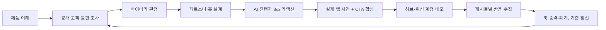

# YoriGO AI UGC GTM Loop

**고객이 공개적으로 말한 불편을 3초 훅으로 바꾸고, AI 크리에이터 계정 네트워크에 매일 배포한 뒤, 게시물별 반응으로 다음 훅과 배포를 결정하는 GTM 루프입니다.**

- 제품: [요리GO](https://yorigo.kr/). 인스타·유튜브에서 저장한 레시피 영상을 재료 정리와 장보기로 바꿔주는 앱
- 행사: Clone Loop Day in Seoul (2026-10-24)
- 실행 화면: `/gtm/loop`. 노드를 클릭하면 검색어, 원문, 판정, 페르소나 이유, 프롬프트, 생성 파일, 게시 ID, 반응, 다음 결정을 볼 수 있습니다.

## 왜 이 고객, 이 형식인가

**고객 가설:** SNS 요리 영상을 저장은 하지만, 다시 찾고 재료를 정리하는 게 번거로워서 실제 요리로 옮기지 못하는 한국어 사용자. 연령·성별을 먼저 추정하지 않고, 최근에 공개적으로 표현한 불편으로 적합성을 판단합니다.

**형식이 제품과 맞는 이유:** 요리GO의 고객은 인스타 릴스에서 레시피를 저장하는 사람들입니다. 그래서 고객이 이미 머무는 곳(릴스)에서, 고객이 이미 겪는 장면(저장만 하고 못 해먹음)을 훅으로 보여주고, 바로 뒤에 그 문제를 푸는 실제 앱 시연을 붙입니다. 광고처럼 보이지 않는 크리에이터 콘텐츠 형식이 저장·공유 습관이 있는 이 고객층에 맞다고 봤습니다.

**AI 진행자 원칙:** AI 인물은 실제 이용자인 척하는 후기가 아니라 창작된 성인 진행자입니다. 인물의 외모는 창작 설정이며 원문 작성자의 인구통계라고 주장하지 않습니다. 실제 경험·숫자를 지어낸 후기형 문구는 쓰지 않습니다.

## 핵심 설계

### 1. 변수는 훅 하나만

영상 구조: **AI 진행자 3초 무음 리액션 + 훅 자막 → 실제 요리GO 앱 시연 → CTA**

페르소나와 앱 시연은 고정하고, 첫 3초 훅 자막만 바꿉니다. 영상을 매번 새로 생성하지 않으니 생성 비용을 아끼고, 반응 차이를 훅 차이로 읽을 수 있습니다.

### 2. 허브 + 위성 계정 구조

| 역할 | 하는 일 |
| --- | --- |
| 허브 계정 | 검증된 훅과 댓글 키워드 CTA로 도달을 크게 만듦 |
| 위성 계정 (페르소나별) | 같은 포맷에서 훅만 바꿔 싸게 대량 실험 |

위성에서 반응이 좋은 훅을 다른 위성과 허브로 옮기고(승격), 반응이 없는 훅은 버립니다. 페르소나는 자취 직장인, 맞벌이 신혼, 워킹맘, 운동하는 1인 가구처럼 요리GO의 사용 장면별로 나눕니다.

### 3. 훅 작성 기준

- 구체적 생활 장면(인스타에 레시피 저장, 요리 순서 보려고 릴스 반복 재생, 마트에서 재료 헤매기)으로 시작
- 뒤늦은 발견·후회·궁금증으로 짧게 닫고, 해결 방법은 말하지 않고 바로 뒤 앱 시연에 맡김
- 30~33자 안팎의 한 문장 구어체
- 제외: "~하는 사람?"처럼 청자를 불러놓고 끝나는 문장, 이유 없는 시청 명령, 막연한 감탄, 지어낸 후기
- 훅 유형 7개(뒤늦은 발견, 콜아웃, 구체적 불편 장면, 결과 먼저, 돈·장보기, 관계, 호기심)로 훅 뱅크를 관리

## 루프



1. **제품 이해:** 제품 도메인에서 확인 가능한 기능과 근거를 저장
2. **고객 불편 조사:** Tavily로 공개 원문 검색. 검색어·조회 시각·게시 날짜·URL·본문 저장
3. **바이너리 판정:** OpenAI가 짧은 정확 인용을 뽑고, 코드가 원문 일치·날짜·중복·제품 기능 연결을 검사. 날짜가 없으면 UNKNOWN. 근거가 부족하면 검색을 최대 세 번 바꾸고, 그래도 부족하면 중단
4. **페르소나·훅 설계:** 통과한 원문과 검증된 기능에 연결된 고객 정의, 가상 인물, 훅, CTA를 Structured Outputs로 생성. 훅 작성 기준으로 걸러냄
5. **페르소나 생성:** Higgsfield Soul 이미지 생성, 원격 작업 ID 보존
6. **리액션 영상 생성:** 같은 인물로 무음 리액션 영상 생성, 3초 사용
7. **앱 시연 합성:** FFmpeg로 실제 녹화·훅·CTA·AI 진행자 표시를 MP4로 합성·검사
8. **배포:** 허브·위성 계정에 하루 두 슬롯(고정 시간대)으로 게시. 게시 ID와 링크 보존
9. **반응 수집:** 게시물별 조회·댓글을 수집하고 앱의 실제 생성·저장 이벤트와 연결
10. **학습·재실행:** 아래 판단 규칙으로 다음 라운드를 결정

### 판단 규칙

| 관측 | 다음 행동 |
| --- | --- |
| 표본이 작음 (게시 후 관찰 시간·조회 부족) | 결론 내리지 않고 대기. 새 비용을 쓰지 않음 |
| 한 위성에서 반응 좋은 훅 | 다른 위성에 이식해 계정과 무관하게 재현되는지 확인 |
| 여러 계정에서 재현된 훅 | 허브로 승격, 댓글 키워드 CTA 붙여 배포 |
| 계속 반응 없는 훅 | 폐기, 훅 기준에 제외 사례로 추가 |
| 새 계정 노출이 거의 없음 | 게시량을 늘리지 않고 워밍업 후 확대 |
| 조회는 있는데 가입·활성이 없음 | 콘텐츠가 아니라 전환 경로(DM 링크, 유입 추적, 첫 사용 흐름)를 점검 |
| 포맷이 여러 계정에서 재현됨 | 같은 포맷으로 위성 계정 확장 |

조회수가 높은 영상을 자동으로 승자로 정하지 않습니다. 계정 효과와 훅 효과가 섞인 결과는 다른 계정 A/B로 분리한 뒤 판단합니다.

### 활성화 정의

신규 사용자가 자기가 저장한 레시피 링크를 요리GO로 분석하고, 24시간 안에 그 레시피를 저장하면 활성으로 봅니다. 조회·클릭·설치·구매를 구분하고, 장보기 이동을 매출로 바꾸지 않습니다.

## 문서

- [루프 개선 기록](docs/ITERATIONS.md)
- [7일 운영 계획](docs/SEVEN_DAY_PLAN.md)
- [제출 문안과 목표](docs/SUBMISSION.md)
- [실행/복구 및 앱 이벤트 연결](docs/GTM.md) · [아키텍처](docs/ARCHITECTURE.md) · [보안](docs/SECURITY.md)
- `reports/`: 날짜별 운영 기록

## 실행

Node.js 24+, FFmpeg/ffprobe, 한글 글꼴이 필요합니다. 로컬 PC 또는 직접 준비한 서버에서 웹과 워커를 실행합니다.

```bash
npm ci
cp .env.example .env.local
# GTM_ADMIN_TOKEN, GTM_EVENTS_TOKEN에 각각 다른 32자 이상 값을 설정
# GTM_FONT_PATH를 실제 한글 글꼴 경로로 설정
npm run dev
# 두 번째 터미널
npm run gtm:worker
```

`http://localhost:3000/gtm/loop` 접속 → 운영 키 로그인 → 연결 설정 → 제품 주소·시연 입력 → 라이브 루프 시작. Tavily, OpenAI(Structured Outputs), Higgsfield API, Instagram 프로 계정 토큰을 연결합니다. 연결 키는 서버에서 암호화하며 브라우저 localStorage에 저장하지 않습니다. 생성 공급자와 Instagram이 미디어를 가져가려면 `GTM_PUBLIC_URL`에 HTTPS origin이 필요합니다. Docker는 선택 사항이며 [compose.yaml](compose.yaml)을 제공합니다.

```bash
npm run seven-day:prepare -- --demo-path /absolute/path/app-demo.mov
npm run seven-day:run
npm run seven-day:status
```

결과가 불명확한 외부 요청은 중복 과금·중복 게시를 막기 위해 자동 재제출하지 않고, 원격 작업 ID로 복구합니다.

## 검증

```bash
npm run test
npm run test:gtm
npm run test:loop
npm run typecheck
npm run build
npx playwright install chromium
npm run test:e2e
```

2라운드 계약 테스트는 조사 → 판정 → 전략 → 이미지 → 영상 → 합성 → 게시 응답 → 관측 → 다음 조사를 검증합니다. 테스트 응답(`mode=test`)의 숫자는 실제 트랙션에 합산하지 않습니다.
