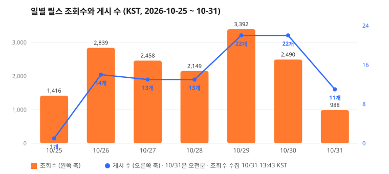
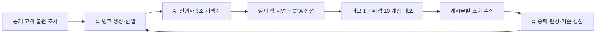

# YoriGO AI UGC GTM Loop

**요리GO의 고객 불편을 3초 훅으로 바꾸고, AI 크리에이터 계정 네트워크에 매일 배포한 뒤, 조회 데이터로 다음 훅을 고르는 GTM 루프입니다.**

- 제품: [요리GO](https://yorigo.kr/). 인스타·유튜브에서 저장한 레시피 영상을 재료 정리와 장보기로 바꿔주는 앱
- 행사: Clone Loop Day in Seoul (2026-10-24)
- 운영 기간: 2026-10-24 ~ 10-31 18:00 KST (7일)
- 최종 결과 보고서: [reports/2026-10-31-final.md](reports/2026-10-31-final.md) · 게시물 원자료: [data/instagram-reels-2026-10-24_31.csv](data/instagram-reels-2026-10-24_31.csv)

## 7일 결과

| 운영 계정 | 게시 릴스 | 누적 조회 | 1,000회 이상 릴스 | 100회 이상 릴스 | 운영일 |
| --- | --- | --- | --- | --- | --- |
| **11개** | **96개** | **15,732회** | **6개** | **64개 (67%)** | **7일 중 7일** |



- 게시 목표 7개 대비 **13.7배**를 올렸습니다. 모든 릴스는 Instagram 게시 ID와 링크가 남아 있어 바로 열어볼 수 있습니다.
- 계정 7개로 시작해서 10/29에 11개로 늘렸습니다. 하루 게시량은 14개에서 22개가 됐습니다.
- 7일 동안 고유 훅 51개를 실전에서 테스트했습니다.
- 조회수는 10/31 13:43 KST에 수집했습니다. 행사 시작 전에 올라간 게시물 1개는 뺐습니다.

## 목표 대비

| 10/24 제출 목표 | 목표 | 결과 | |
| --- | --- | --- | --- |
| 실제 게시한 영상 | 7개 | **96개** | 달성 (13.7배) |
| 근거를 남긴 반복 학습 | 3회 이상 | **5회** ([ITERATIONS](docs/ITERATIONS.md)) | 달성 |
| 캠페인 귀속 신규 활성 사용자 | 20명 | 릴스→설치 귀속 장치 미연결로 측정 불가 | v2 핵심 과제 |
| 독립 원문 고객 신호 | 20건 | 별도 집계 없음. 이번 주는 훅 실험에 집중 | v2 |
| 검증된 제휴 구매·매출 | 관측 | 0원 | 관측 |

목표는 10/24 원문 그대로 두었습니다. 원래 제출 문안은 [docs/SUBMISSION.md](docs/SUBMISSION.md)에 있습니다.

## 이 루프가 다른 점

**1. 허브 1개 + 위성 10개 계정 구조**

| 역할 | 계정 | 릴스당 평균 조회 | 하는 일 |
| --- | --- | --- | --- |
| 허브 | @yejin.jubu | 701회 (최고 1,416) | 검증된 훅과 댓글 CTA로 도달을 크게 만듦 |
| 위성 | 페르소나 10개 | 약 80회 (안정 계정은 110~155) | 같은 포맷에서 훅 하나만 바꿔 대량 실험 |

허브는 크게 터뜨리고, 위성은 싸게 많이 실험합니다. 위성에서 반응이 좋은 훅을 허브와 다른 위성으로 옮깁니다.

**2. 변수는 훅 하나만**

AI 진행자(Higgsfield 페르소나)의 3초 무음 리액션 + 훅 자막 → 실제 요리GO 앱 시연 → CTA. 페르소나와 시연은 고정하고 첫 3초 훅만 바꿉니다. 영상 한 편을 새로 만들지 않고 훅 자막만 갈아 끼우니 생성 비용을 아끼고, 조회수 차이를 훅 차이로 읽을 수 있습니다.

**3. 루프**



## 7일 동안 루프가 바뀐 과정

| 날짜 | 관측 | 바꾼 것 |
| --- | --- | --- |
| 10/26 | 허브 과거 릴스: 뒤늦은 발견형 훅 1.1천~1.5천회, 명령형·육아형 170~290회 | 훅 뱅크를 7개 유형으로 만들고 위성 계정 6개 동시 가동 |
| 10/27~28 | 먼저 연 위성 계정 다수가 릴스당 100~200회로 안정 | 반응 좋은 훅을 여러 계정에 이식 ("집들이 메뉴 저장한 릴스로 다 해결함" 10회 사용, 최고 207회) |
| 10/29 | 같은 포맷이 계정을 바꿔도 재현됨 | 계정 7개 → 11개, 하루 14개 → 22개 |
| 10/30 | 오후·저녁 슬롯 운영 | 게시 슬롯을 오전 10시대·오후 5시대로 고정 |
| 10/31 | 훅 후보 128개 검토 | 19개만 남김. 기준: 구체적 장면 → 뒤늦은 발견 → 해결은 시연에 맡김, 30~33자, "~하는 사람?" 종결 제외 |

자세한 근거: [docs/ITERATIONS.md](docs/ITERATIONS.md)

## 데이터가 알려준 것

- **댓글 키워드 CTA:** "댓글에 '저장' 남겨주시면 링크 보내드려요"를 붙인 릴스는 평균 **1,243회**, 안 붙인 릴스는 평균 117회였습니다. 4개 모두 허브 계정이라 v2에서 위성 계정으로 A/B 검증합니다.
- **계정 신뢰도:** 10/26부터 운영한 위성은 꾸준히 100회 이상을 받았고, 10/29에 연 새 계정은 첫 며칠 0~5회가 많았습니다. 새 계정은 워밍업이 필요합니다.
- **도달 다음 단계:** 조회는 만들었지만 릴스에서 앱 설치로 넘어가는 길(DM 링크, 계정별 UTM/딥링크)이 없어 가입 효과를 따로 셀 수 없었습니다. v2의 첫 과제입니다.

## v2

1. 댓글 키워드 → DM 자동 링크(ManyChat) + 계정별 UTM/딥링크로 조회 → 설치 → 가입을 연결
2. 댓글 CTA를 위성 전체에 적용해 CTA 효과와 계정 효과를 분리
3. 신규 위성은 3~5일 워밍업 후 게시량 확대
4. 10/31 확정 훅 19개 회전, 1,000회 이상 훅만 허브로 승격

## 계정별 결과

| 계정 | 역할 | 시작 | 릴스 | 조회 | 평균 | 최고 |
| --- | --- | --- | --- | --- | --- | --- |
| @yejin.jubu | 허브 | 10/25 | 13 | 9,116 | 701 | 1,416 |
| @jieunnie9 | 위성 | 10/26 | 10 | 1,551 | 155 | 207 |
| @yujin.kidsplate | 위성 | 10/26 | 11 | 1,285 | 117 | 142 |
| @junho.mealprep | 위성 | 10/26 | 10 | 1,128 | 113 | 145 |
| @sumin.jubu | 위성 | 10/26 | 10 | 964 | 96 | 158 |
| @jiwoo00o | 위성 | 10/26 | 11 | 612 | 56 | 144 |
| @sohyeonnie.e | 위성 | 10/26 | 11 | 606 | 55 | 127 |
| @seoyeon.afterwork9 | 위성 | 10/29 | 5 | 355 | 71 | 134 |
| @haeunnn1 | 위성 | 10/29 | 5 | 111 | 22 | 111 |
| @suaaa.96 | 위성 | 10/29 | 5 | 4 | 1 | 1 |
| @jieun.tableee | 위성 | 10/29 | 5 | 0 | 0 | 0 |
| **합계** | | | **96** | **15,732** | **164** | **1,416** |

## 실행

Node.js 24+, FFmpeg/ffprobe, 한글 글꼴이 필요합니다. 로컬 PC 또는 직접 준비한 서버에서 웹과 워커를 실행합니다.

```
npm ci
cp .env.example .env.local
# GTM_ADMIN_TOKEN, GTM_EVENTS_TOKEN에 각각 다른 32자 이상 값을 설정
# GTM_FONT_PATH를 실제 한글 글꼴 경로로 설정
npm run dev
# 두 번째 터미널
npm run gtm:worker
```

`http://localhost:3000/gtm/loop` 접속 → 운영 키 로그인 → 연결 설정 → 제품 주소·시연 입력 → 라이브 루프 시작. Tavily, OpenAI(Structured Outputs), Higgsfield API, Instagram 프로 계정 토큰을 연결합니다. 생성 공급자와 Instagram이 미디어를 가져가려면 `GTM_PUBLIC_URL`에 HTTPS origin이 필요합니다. Docker는 선택 사항이며 [compose.yaml](compose.yaml)을 제공합니다.

```
npm run seven-day:prepare -- --demo-path /absolute/path/app-demo.mov
npm run seven-day:run
npm run seven-day:status
```

검증: `npm run test`, `npm run test:gtm`, `npm run test:loop`, `npm run typecheck`, `npm run build`, `npm run test:e2e`. 테스트 리플레이(`mode=test`)의 숫자는 실제 트랙션에 합산하지 않습니다.

문서: [7일 운영 계획](docs/SEVEN_DAY_PLAN.md) · [실행/복구](docs/GTM.md) · [아키텍처](docs/ARCHITECTURE.md) · [보안](docs/SECURITY.md)
