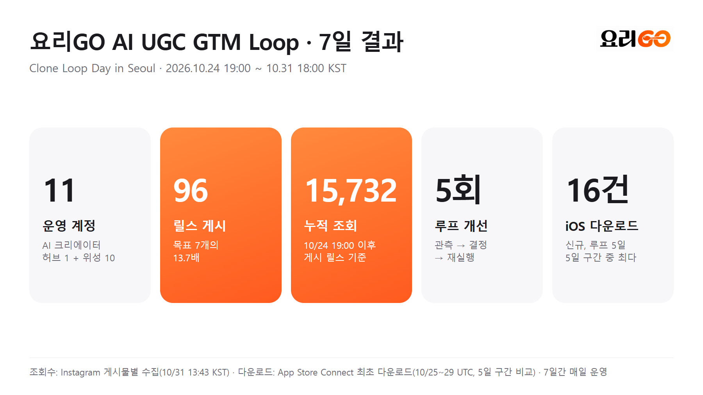
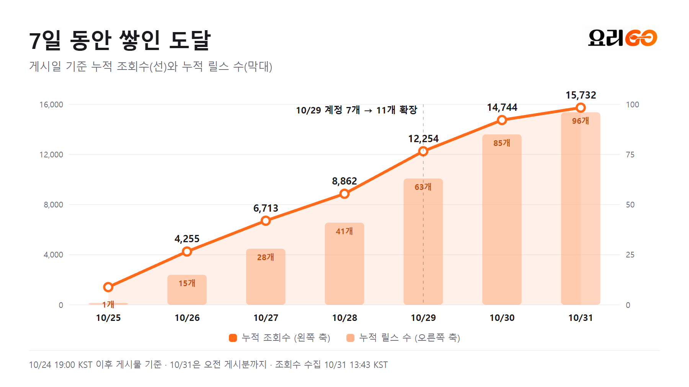
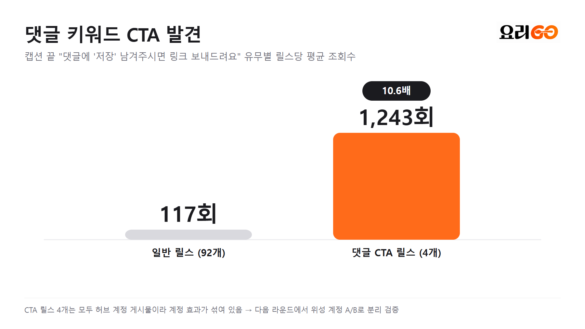
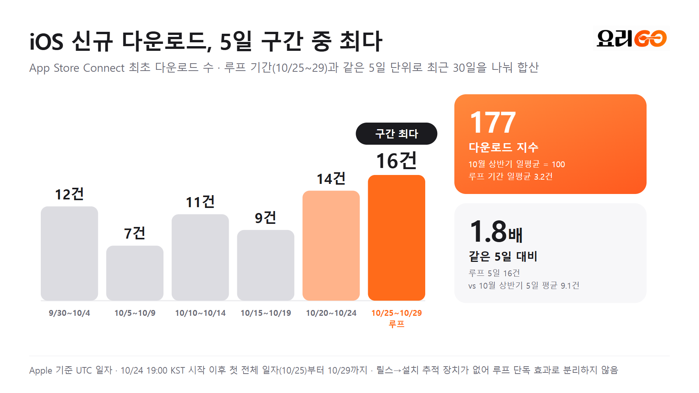

# 7일 최종 결과 보고서 (2026-10-24 19:00 ~ 10-31 18:00 KST)

## 요약

허브 1개 + 위성 10개, 총 11개 AI 크리에이터 계정으로 7일 동안 하루도 빠짐없이 루프를 돌렸습니다. 릴스 96개를 올려 누적 조회 15,732회를 만들었고, 게시 목표(7개)의 13.7배를 달성했습니다. 중간 결과를 보고 루프를 5번 바꿨습니다. 7일 동안 확인한 가장 큰 레버는 댓글 키워드 CTA(평균 1,243회 vs 117회)와 계정 신뢰도였습니다. 남은 과제는 조회를 가입으로 잇는 귀속 경로입니다.

## 측정 기준

- 조회수: Instagram 게시물별 조회수, 10/31 13:43 KST 수집. 원자료는 [data/instagram-reels-2026-10-24_31.csv](../data/instagram-reels-2026-10-24_31.csv)
- 가입: Mixpanel `sign_up` 이벤트 (요리GO 프로젝트, 보드 "Yorigo 핵심 제품 지표")
- 범위: 10/24 19:00 KST(해커톤 종료) 이후 게시물만. 10/24 오전에 올라간 허브 게시물 1개(1,504회)는 제외

## 목표 대비 결과

| 지표 (10/24 제출 목표) | 목표 | 결과 | 판정 |
| --- | --- | --- | --- |
| 실제 게시한 영상 | 7개 | **96개** (11개 계정, 게시 ID·링크 보존) | 달성 (13.7배) |
| 근거를 남긴 반복 학습 | 3회 이상 | **5회** ([ITERATIONS](../docs/ITERATIONS.md)) | 달성 |
| 누적 도달 | 관측 | **15,732회** | 관측 |
| 전체 신규 가입 (Mixpanel) | 관측 | 루프 기간(10/25~30) 일평균 **4.2명**, 10월 상반기(2.9명) 대비 높은 수준 유지 | 관측 (루프 단독 효과는 미분리) |
| iOS 신규 다운로드 (App Store Connect) | 관측 | 루프 5일(10/25~29, UTC) **16건** · 5일 단위 구간 중 최다 · 10월 상반기 대비 지수 **177** | 관측 (루프 단독 효과는 미분리) |
| 캠페인 귀속 신규 활성 사용자 | 20명 | 대리 지표(iOS 신규 다운로드)로 추적 · 직접 귀속(DM 링크·UTM)은 이어서 연결 | 대리 지표 |
| 독립 원문 고객 신호 | 20건 | 별도 집계 없음 | 미집계 |
| 검증된 제휴 구매·매출 | 관측 | 0원 | 관측 |

## 운영 기록

| 날짜 (KST) | 게시 | 조회 | 운영 계정 | 슬롯 |
| --- | --- | --- | --- | --- |
| 10/25 | 1 | 1,416 | 1 (허브) | 오전 |
| 10/26 | 14 | 2,839 | 7 | 오후·저녁 |
| 10/27 | 13 | 2,458 | 7 | 저녁 |
| 10/28 | 13 | 2,149 | 7 | 오후 |
| 10/29 | 22 | 3,392 | 11 | 오후·저녁 |
| 10/30 | 22 | 2,490 | 11 | 10시대·17시대 |
| 10/31 (오전) | 11 | 988 | 11 | 10시대 |
| **합계** | **96** | **15,732** | **11** | |

- 1,000회 이상 릴스 6개, 100회 이상 릴스 64개(67%)
- 고유 훅 51개 테스트, 반응 좋은 훅은 여러 계정에 재사용

## 상위 릴스

| 조회 | 계정 | 훅 | 링크 |
| --- | --- | --- | --- |
| 1,416 | @yejin.jubu | 레시피 릴스를 저장만 하면서 시간을 얼마나 낭비한거야 (+댓글 CTA) | [열기](https://www.instagram.com/reel/De5iDqbFMMp/) |
| 1,238 | @yejin.jubu | 이거 쓰면 드디어 남편이 내 요리를 칭찬해줄까? (+댓글 CTA) | [열기](https://www.instagram.com/reel/De8ndB3DOiG/) |
| 1,205 | @yejin.jubu | 요리 잘하는 친구가 알려준 미친 앱 (+댓글 CTA) | [열기](https://www.instagram.com/reel/DfBiXhsgMdl/) |
| 1,176 | @yejin.jubu | 고백하면 요리 안 했어 | [열기](https://www.instagram.com/reel/DfGaJYZCrmp/) |
| 1,118 | @yejin.jubu | 이거 보고 눈이 번쩍 뜨임 | [열기](https://www.instagram.com/reel/De_vUyRAmKN/) |
| 1,111 | @yejin.jubu | 다들 릴스를 이렇게 저장하고 있었다고?? (+댓글 CTA) | [열기](https://www.instagram.com/reel/DfEJijdggAn/) |
| 967 | @yejin.jubu | 이 레시피는 꼭 해보고 싶은데? | [열기](https://www.instagram.com/reel/DfEJH9KAIvt/) |
| 207 | @jieunnie9 | 집들이 메뉴 저장한 릴스로 다 해결함 | [열기](https://www.instagram.com/reel/DfHJmP9AKd1/) |
| 207 | @jieunnie9 | 재료 보려고 릴스 10번 돌려본 사람? | [열기](https://www.instagram.com/reel/DfGYZkdgINg/) |

## 진단

1. **허브·위성 구조가 작동했습니다.** 허브는 릴스당 평균 701회로 도달을 만들었고, 위성은 평균 약 80회(먼저 연 안정 계정은 110~155회)로 훅을 싸게 대량 실험했습니다.
2. **댓글 키워드 CTA가 가장 큰 레버 후보입니다.** CTA 릴스 4개 평균 1,243회, 나머지 92개 평균 117회. 4개 모두 허브 계정이라 계정 효과와 섞여 있어, v2에서 위성 A/B로 분리합니다.
3. **새 계정은 워밍업이 필요합니다.** 10/29에 연 위성 4개 중 2개는 첫 5개 릴스가 0~1회였습니다.
4. **가입은 높은 수준을 유지했지만, 루프 효과로 분리하진 못했습니다.** Mixpanel `sign_up` 일평균은 10월 상반기(10/1~16) 2.9명, 루프 기간(10/25~30) 4.2명입니다. 상승은 루프 직전 주부터 시작됐고, 릴스에서 설치로 넘어가는 DM 링크와 계정별 UTM/딥링크가 없어 루프 귀속 가입은 따로 셀 수 없었습니다.

5. **iOS 신규 다운로드는 5일 단위 구간 중 최다였습니다.** App Store Connect 최초 다운로드를 루프 기간(10/25~29, UTC)과 같은 5일 단위로 나누면 12 → 7 → 11 → 9 → 14 → **16건**입니다. 일평균은 10월 상반기 1.8건 → 루프 기간 3.2건(지수 177)입니다.

## 그래프

## v2 계획

1. 댓글 키워드 → DM 자동 링크(ManyChat) + 계정별 UTM/딥링크로 조회 → 설치 → 가입 → 레시피 저장(활성)까지 연결
2. 위성 전체에 댓글 CTA A/B 적용
3. 신규 위성은 3~5일 워밍업 후 게시량 확대
4. 10/31 확정 훅 19개 회전, 1,000회 이상 훅만 허브로 승격

## 부록: Mixpanel `sign_up` 일별

| 기간 | 일별 | 합계 |
| --- | --- | --- |
| 10/1~16 | 2, 3, 4, 1, 3, 2, 0, 2, 2, 8, 4, 4, 3, 3, 3, 2 | 46 (일평균 2.9) |
| 10/17~23 | 1, 7, 2, 9, 6, 4, 6 | 35 |
| 10/24~30 | 6, 7, 1, 7, 1, 7, 2 | 31 (루프 기간 10/25~30: 25, 일평균 4.2) |
| 10/31 | 0 (17:50 KST 기준, 집계 중) | |
